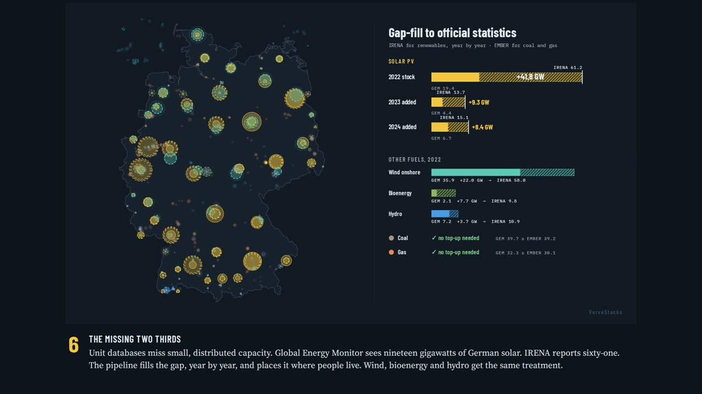
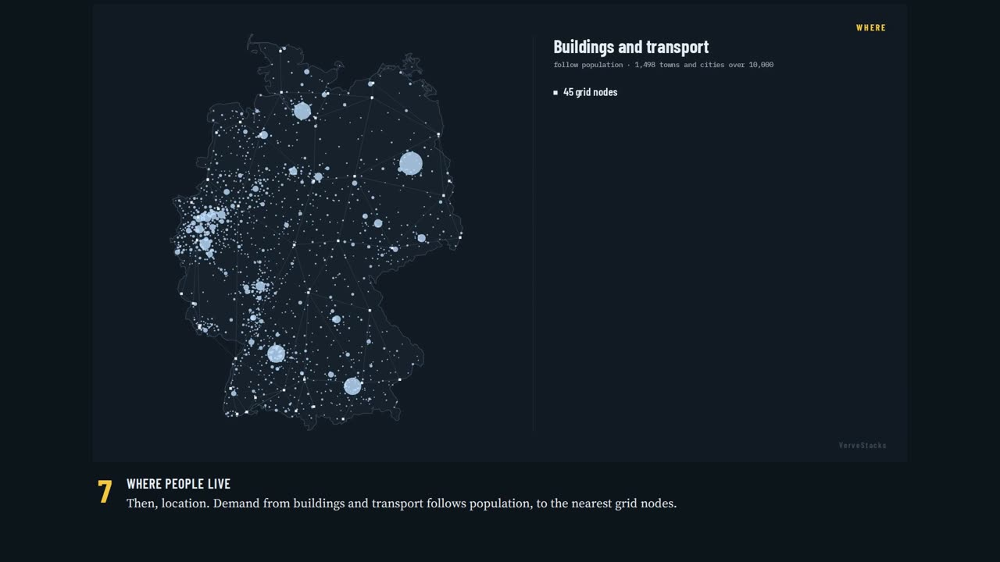
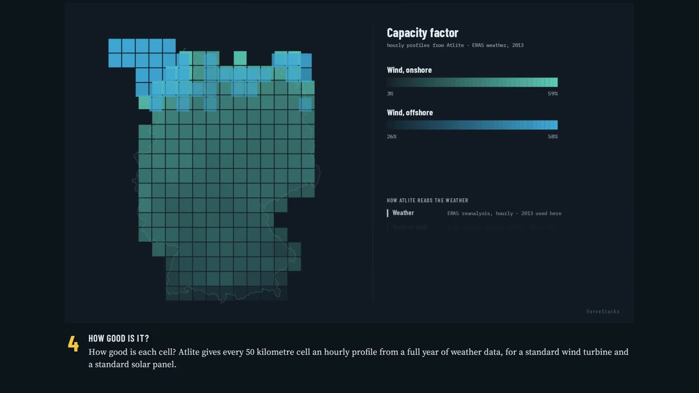
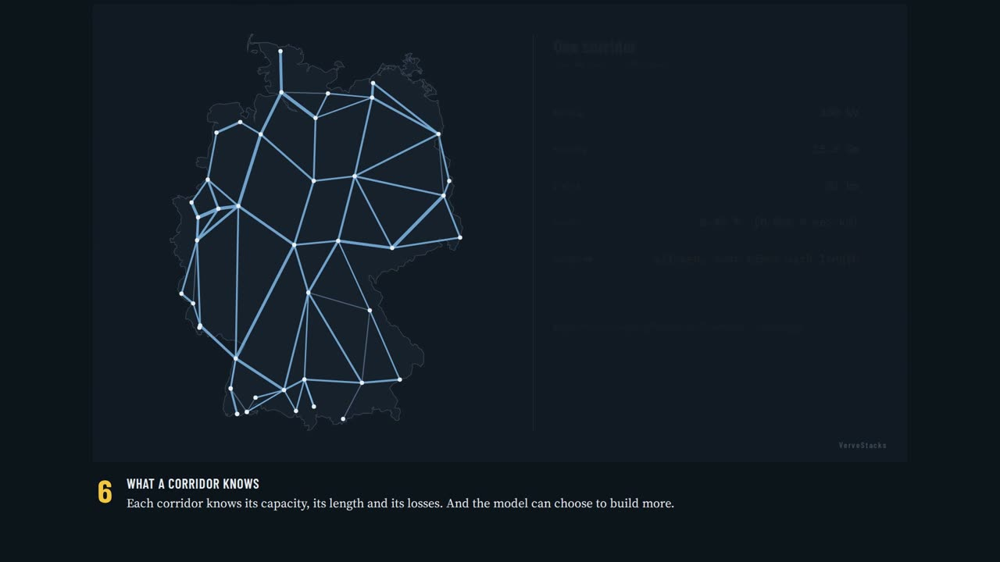
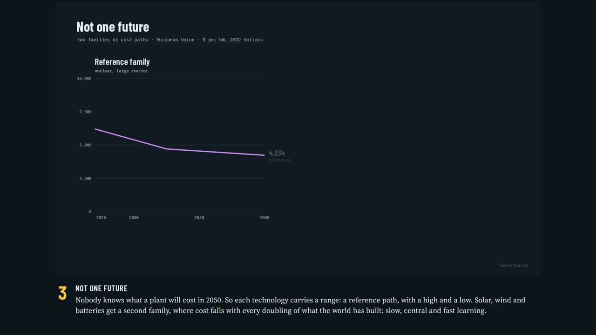
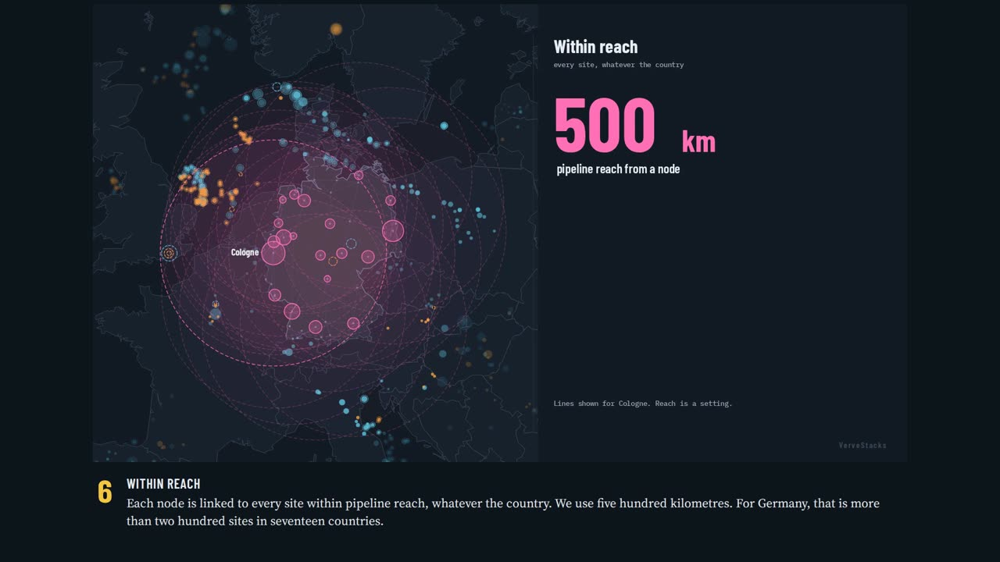

# VerveStacks — Open‑Use Energy Modeling

**Your country's power system, already built. Calibrated to its own statistics, open to inspect, ready to run.**

[Get started](getting-started/quickstart.md){ .md-button .md-button--primary }
[Browse countries](model-library/coverage-map.md){ .md-button }
[Watch the films](#watch-a-model-being-built){ .md-button }

Most energy-modeling projects spend their first year building the model. VerveStacks starts where that year would end. Each model is a TIMES model of a real country: its actual power plants unit by unit, its actual transmission network, its wind and sun cell by cell, its demand placed where people live and industry works. Every model is assembled by the same pipelines from open global data, so you can spend your time on the question rather than on the build.

## What is inside one model

Germany, as built on 1 October 2026. Every number below comes from that build.

-   **12,088 → 248**

    ---

    Power units in Global Energy Monitor, reduced to the 248 large units the model tracks one by one (88.9 GW). The rest are pooled by fuel, size and node. Capacity missing from unit data is filled year by year from official statistics.

-   **795 → 45**

    ---

    Real substations in the mapped network, folded into 45 nodes and 78 corridors. Each node is a real substation, kept by a stated rule. 34 links reach 10 neighbouring countries.

-   **415 → 92**

    ---

    50 km weather cells with usable land for solar, onshore and offshore wind, grouped into 92 clusters around grid nodes. Each cluster keeps its own hourly profile from ERA5 weather data.

-   **8,760 → 12 to 220**

    ---

    Hours in the year, reduced to time slices: the 365 days are grouped into seasons of similar net load, and the hours into periods of the day. Several resolutions ship with every model.

-   **63 technologies**

    ---

    One cost table from six public sources, in USD 2022, with high and low paths, and learning paths for solar, wind and batteries. Country builds use the reference path today.

-   **1,154 storage sites**

    ---

    CO₂ storage sites in the OGCI catalogue, each with a capacity and a cost, feeding the optional carbon-capture module. Large coal and gas units carry capture retrofit options (85 in Germany).

## Watch a model being built

Six two-minute films, each generated from the German build. They show the transformation step by step, and every number on screen traces to a file. Each film opens the matching page under *Under the Hood*. Interactive versions, and five of the films for India, are in the [film hub](films/index.html).

<figure class="vs-film" markdown="0">
  <video controls preload="none" playsinline poster="_static/films/deu_power_grid.jpg">
    <source src="_static/films/deu_power_grid.mp4" type="video/mp4">
  </video>
  <figcaption><strong>Germany's Power Grid</strong> (1:59). From 795 substations to 45 nodes, by rule.</figcaption>
</figure>

  <a href="methods/existing-stock-characterization/"><strong>Power Fleet</strong> 1:48</a>
  <a href="methods/electricity-demand/"><strong>Electricity Demand</strong> 1:55</a>
  <a href="methods/renewable-characterization/"><strong>Wind and Sun</strong> 2:02</a>
  <a href="methods/grid-representation/"><strong>Power Grid</strong> 1:59</a>
  <a href="methods/new-technologies/"><strong>New Technology Costs</strong> 2:08</a>
  <a href="_static/films/deu_co2_storage.mp4"><strong>CO₂ Storage</strong> 2:33</a>

## How it works

  

    
1 · Open data

    <ul>
      <li>Power plants: Global Energy Monitor</li>
      <li>Statistics: IRENA, Ember, UN</li>
      <li>Grid: OpenStreetMap</li>
      <li>Weather: ERA5 via Atlite</li>
      <li>Land: REZoning (ESMAP)</li>
      <li>Costs: IEA WEO, NREL ATB, DEA</li>
      <li>Scenarios: IPCC AR6</li>
      <li>CO₂ storage: OGCI catalogue</li>
    </ul>
  

  
→

  

    
2 · VerveStacks pipelines

    <ul>
      <li>Existing plants, filled to statistics</li>
      <li>Demand: level, growth, sectors, shape, place</li>
      <li>Wind and sun clusters with hourly profiles</li>
      <li>Grid nodes and corridors</li>
      <li>New technologies and costs</li>
      <li>Time slices by net-load clustering</li>
      <li>Checks against official statistics</li>
    </ul>
  

  
→

  

    
3 · Country model

    <ul>
      <li>Veda-TIMES model files, readable in Excel</li>
      <li>Single-region or grid version</li>
      <li>Scenario drivers: AR6 climate categories, hydro availability</li>
      <li>Versioned on GitHub</li>
    </ul>
  

  
→

  

    
4 · Your analysis

    <ul>
      <li>Run and compare in Veda Online, no install</li>
      <li>Or download and run with Veda and TIMES</li>
      <li>Change any assumption; add your own data</li>
      <li>Results by plant, node, time slice and year</li>
    </ul>
  

The pipelines are where the effort goes, and they are maintained by KanORS-EMR. The models they produce, and every assumption in them, are open to use and inspect. See [Data Lineage](data-assumptions/data-lineage.md) for how any parameter traces back to its source.

## Why it is different

**You learn on your own system.** The first model a new modeller opens is their own country: plants they know by name, a grid they recognise, demand where their cities are. Learning becomes immediately relevant, and the questions they ask are the ones they will be asked at work.

**Calibrated by construction.** The base year is not tuned after the fact. Where unit data falls short of official capacity statistics, the gap is filled year by year, so the base-year fleet starts from the statistics rather than from an incomplete plant list. Generation and fuel use are then checked against Ember, IRENA and UN statistics in every build, and where sources disagree the model shows the gap. See [Calibration & Checks](data-assumptions/calibration.md).

**Detail without the build cost.** Unit-level plants, real substations, cell-level renewables and data-driven time slices are normally the product of a multi-year project. Here they are the starting point, and the same structure is available for every country in the library.

**Every number has an address.** Each parameter traces to a named source and a file in the pipeline. Assumptions can be challenged one at a time, and a better one can be dropped in without rebuilding the rest.

## Who it is for

| You are | What VerveStacks gives you |
|---|---|
| A ministry, regulator or utility without an in-house modelling team | A model of your own system to explore plans, targets and trade-offs, without commissioning a build first |
| A development bank or donor | Consistent, comparable models across a portfolio of countries, and a shared base for technical assistance |
| A company or national champion | A transparent view of how a country's power system may evolve, at the level of plants and grid nodes |
| A modelling team or consultancy | A calibrated, high-resolution starting point, so project time goes into scenarios and interpretation |
| A teacher or student | A real country's system to learn on, with every step of its construction documented and filmed |

The common thread: people who would benefit from a rich, reliable model but have assumed they would first have to build one.

## Data sources at a glance

| Source | Provides | Used for |
|---|---|---|
| Global Energy Monitor (power, solar, wind, industry trackers) | Unit-level plants and industrial sites with coordinates and status | Existing fleet, new-build pipeline, industrial demand placement |
| IRENA statistics | Renewable capacity and generation by country | Filling gaps in unit data; checks |
| Ember | Electricity generation, capacity and demand; national renewable targets | Base-year demand; checks; hydro seasonality; target tables |
| UN Statistics Division | Energy balances | Fuel-use checks; gap-filling |
| IEA World Energy Balances | Sectoral energy use | Industry split; combined heat and power ratios |
| OpenStreetMap (via PyPSA prebuilt networks) | Substations and lines | Grid nodes and corridors |
| REZoning (World Bank ESMAP) | Usable land for solar and wind at 50 km | Renewable potential and connection distance |
| ERA5 via Atlite | Hourly weather, four weather years | Wind and solar capacity factors |
| ERA5-based load, ENTSO-E, national data | Hourly electricity load | Demand shape; time-slice design |
| IEA World Energy Outlook, NREL ATB, Danish Energy Agency, IRENA costs, EIA, Lazard | Technology costs and performance | New-technology cost table |
| Damodaran | Country risk and cost of capital | Cost-of-capital table by country and technology (not yet read by country builds) |
| IPCC AR6 scenario database (R10) | Demand growth, sector shares, fuel and carbon prices | Scenario drivers to 2050 |
| OGCI CO₂ Storage Resource Catalogue | Storage sites and capacities | CO₂ storage supply curves |
| PeeringDB | Interconnection facilities | Data-centre siting on grid nodes |
| Natural Earth, world cities | Borders, coastlines, population | Spatial clipping; population key for demand |

Versions, coverage and exact use of each source are on [Source Datasets](data-assumptions/sources.md).

## Open use: what you may do with a model

- **Use it.** Run it, change it, extend it, teach with it, for research, policy analysis, education and non-commercial consulting.
- **Inspect everything.** Every assumption is in the model files and documented here.
- **Your version is yours.** A model you modify, the scenarios you add and the results you produce belong to you. They do not have to be published, and they can stay private.
- **Credit the base.** If you publish results from a VerveStacks model, cite VerveStacks and the model version. If you redistribute a model, document your changes; commercial redistribution needs permission.

The model-generation pipelines are not public; the reasons are in the [FAQ](getting-started/faq.md). Terms are on the [License](reference/license.md) page.

## The idea behind it

- **Lower the skill barrier to entry.** Proprietary tools have licensing barriers and open-source tools have high skill barriers. Open-use aims to lower both by making the full modeling value chain available to all.
- **Separate building from using.** The craft of building pipelines and models is different from the skill of using models, and the second is where decisions live. VerveStacks exists to create a **new class of modelers — expert users** who ask better questions, run scenarios fast and interpret results with confidence, without having to build the model.
- **Bring in the people closest to reality.** Policymakers, analysts, consultants, researchers and teachers often know the system best but cannot spend months building infrastructure to test a question.
- **Make complexity usable.** Transparent data, explicit methods and practical defaults that travel across countries. Any part of a model can be changed without rebuilding the whole.

## Start here

- [Browse the countries](model-library/coverage-map.md) and open a model
- [Run your first scenario](getting-started/first-scenario.md)
- [See how a model is built](methods/existing-stock-characterization.md), step by step
- [Read what the model does not do](data-assumptions/limitations.md)
