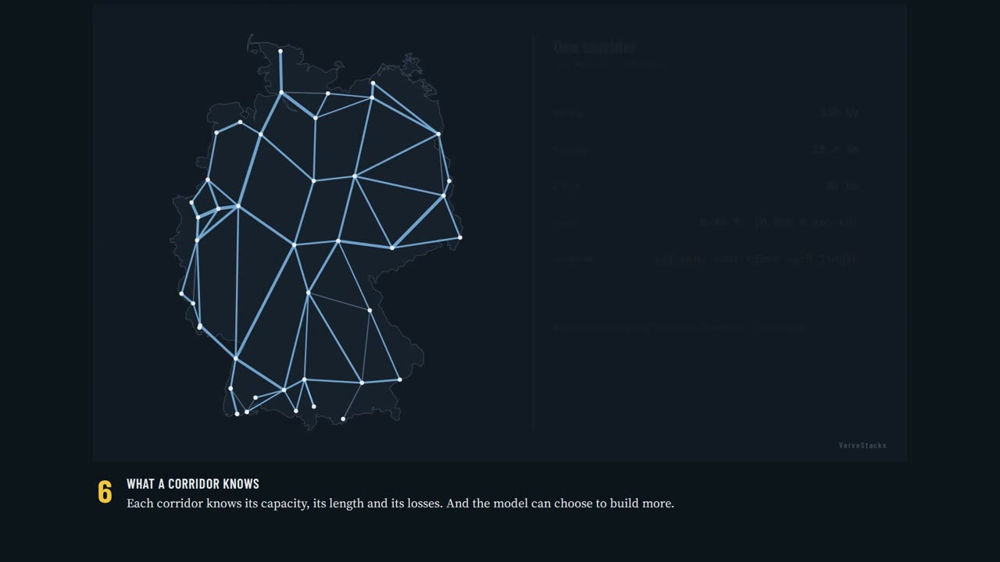

VerveStacks · Open-use energy models

<h1>National energy-system models, built from open data, ready to use.</h1>

A detailed power-system model of your country already exists: its plants, its grid, its wind and sun, its demand. It is calibrated to official statistics and open to anyone.

**Open use.** Every model, and every assumption in it, is open to use and inspect. A model you modify, the scenarios you add and the results you produce are yours, and can stay private. [Terms](reference/license.md)

<h2>Use a model yourself</h2>

For those who rely on modelling results

Most people who depend on energy-system models have never used one. Their answers arrive as spreadsheets and slides from a modelling team, and each new question goes back into the queue.

With VerveStacks and Veda Online you open your own country's model in a browser, change an assumption, run it and read the result: the same model a modelling team would use, with nothing to install.

[Open a country&nbsp;→](model-library/coverage-map.md){ .vs-go }

<h2>Build on a complete base</h2>

For those who build models

Most of a national model is provisioning: every plant, the transmission network, wind and solar resources, demand by place and hour, time slices, technology costs. All of it gathered, reconciled and calibrated before the first real question can be asked.

VerveStacks supplies that 95% for every country in the library, documented to its sources. Take it into your own work and spend your effort on the 5% that is yours.

[What is inside a model&nbsp;→](methods/reference-model.md){ .vs-go }

<figure class="vs-hfilm">
  

    
    <button class="vs-play" type="button" aria-label="Play the video Germany's Power Grid" onclick="var f=document.getElementById('vs-hfilm');f.innerHTML='&lt;video controls autoplay playsinline src=&quot;'+f.querySelector('img').getAttribute('src').replace('.jpg','.mp4')+'&quot;&gt;&lt;/video&gt;';"></button>
  

  <figcaption><strong>Germany's Power Grid</strong> · 1:59, narrated From 795 substations to 45 nodes. One of six method videos on how a country model is built. <a href="films/index.html">All method videos</a></figcaption>
</figure>

## The idea behind it

Energy-system models have always had two barriers in front of them. Proprietary tools put a licence there; open-source tools put a skill barrier there. Either way, the people closest to the decisions, in ministries, regulators, utilities and the teams that answer to them, are kept at arm's length from the model itself.

VerveStacks starts from a separation. Building a model and using a model are different crafts. Building is the provisioning of data, pipelines and structure, and it is where most of a project's time goes. Using is asking questions, designing scenarios and interpreting what comes back, and it is where decisions are made. VerveStacks takes on the building, at scale and in the same way for every country, so that a new class of modellers can concentrate on use: expert users who know their system well and can now work with a model of it directly.

For those who build, the same separation works the other way round. A VerveStacks model is an operating system for a national energy-system model (ESOM): a complete, calibrated base in which any part can be replaced, refined or extended without rebuilding the rest. Complexity is neither hidden nor handed over raw. The data is traceable, the methods are written down and shown in video, and the defaults are chosen to travel from one country to the next.

## What is inside one model

Germany, as built on 1 October 2026. Every number comes from that build; every other country in the library is built the same way.

| Part | From | In the model |
|---|---|---|
| Power units | 12,088 in Global Energy Monitor | 248 large units tracked one by one (88.9 GW); the rest pooled by fuel, size and node, and filled to official statistics year by year |
| Transmission | 795 substations | 45 nodes and 78 corridors, each node a real substation; 34 links to 10 neighbouring countries |
| Wind and sun | 415 weather cells | 92 clusters around grid nodes, each with its own hourly ERA5 profile |
| Time | 8,760 hours | 12 to 220 time slices, grouped by net load |
| New technologies | 6 public sources | 63 technologies in one cost table, USD 2022, with learning paths |
| CO₂ storage | 1,154 sites (OGCI) | Supply curves for the optional capture module; 85 retrofit options in Germany |

## How a model is made

  

Open data
<ul><li>Global Energy Monitor</li><li>IRENA, Ember, UN</li><li>OpenStreetMap</li><li>ERA5 via Atlite</li><li>REZoning</li><li>IPCC AR6</li></ul>

  

Pipelines
<ul><li>Existing plants</li><li>Demand</li><li>Wind and sun</li><li>Grid</li><li>Costs</li><li>Time slices</li><li>Checks</li></ul>

  

Country model
<ul><li>Veda-TIMES files, readable in Excel</li><li>Single-region or grid</li><li>Versioned on GitHub</li></ul>

  

Your analysis
<ul><li>Veda Online, no install</li><li>Or Veda and TIMES on your machine</li><li>Any assumption can change</li></ul>

The pipelines are maintained by KanORS-EMR. The models they produce, and every assumption in them, are open. [Data Lineage](data-assumptions/data-lineage.md) shows how any parameter traces to its source, and [Source Datasets](data-assumptions/sources.md) lists every source.

## Who it is for

| | |
|---|---|
| **Ministries, regulators, utilities** | A model of your own system to test plans, targets and trade-offs, without commissioning a build first. |
| **Development banks and donors** | Comparable models across a portfolio of countries, and a shared base for technical assistance. |
| **Modelling teams and consultancies** | A calibrated, high-resolution starting point, so project time goes into scenarios and interpretation. |
| **Teachers and students** | A real country's system to learn on, with every step of its construction documented in text and video. |

## Start here

- [Browse the countries](model-library/coverage-map.md) and open a model
- [Run your first scenario](getting-started/first-scenario.md)
- [See how a model is built](methods/existing-stock-characterization.md), step by step, in text and video
- [Read what the model does not do](data-assumptions/limitations.md)

