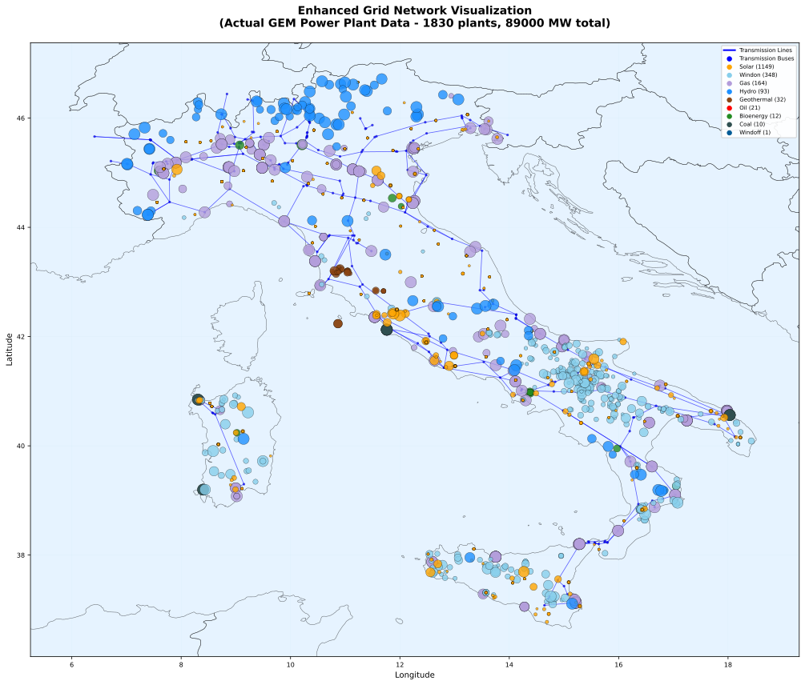

# Grid Representation

**From the real transmission network to a set of nodes and corridors a model can solve**

<figure class="vs-film" markdown="0">
  <video controls preload="none" playsinline poster="../../_static/films/deu_power_grid.jpg">
    <source src="../../_static/films/deu_power_grid.mp4" type="video/mp4">
  </video>
  <figcaption><strong>Watch first: Germany's Power Grid</strong> (1:59, narrated). Generated from a real build of the German model; every number on screen traces to a file. The sections below follow the film in the same order, with the rules and file names behind each step. Also: <a href="../../films/v/grid_DEU.html">interactive version</a> · <a href="../../films/v/grid_IND.html">India</a> · <a href="../../films/">all films</a>.</figcaption>
</figure>

A VerveStacks model does not treat a country as one point. It keeps a reduced copy of the country's high-voltage network: a set of **nodes**, each a real substation, joined by **corridors**. Plants, demand, wind and solar are all attached to nodes, so the model sees where power is made, where it is used, and what lies between.

The page uses three terms throughout:

| Term     | Meaning                                                                                                                                       |
|--------------|----------------------------------------------------------|
| Node     | A substation that survives simplification. In the code and file names it is a *bus*; in the model it is the electricity commodity `e_<node>`. |
| Corridor | All the lines between two nodes, taken together. In the model it is the process `g_<node>-<node>`.                                            |
| Cluster  | A group of wind or solar cells attached to one node (see [Renewable Energy Characterization](renewable-characterization.md)).                               |

## The method in five steps

1.  Start from the mapped network: every substation and line in OpenStreetMap.
2.  Choose which substations stay as nodes, by rule.
3.  Fold every other substation into its nearest node.
4.  Merge the lines between each pair of nodes into one corridor.
5.  Attach plants, demand, wind and solar to the nodes.

How many nodes to keep is a choice, not a property of the data. The same method gives Germany 37, 45, 481 or 795 nodes, and India 18, 50 or 348.

## 1. The starting network

| Dataset | Coverage  | Source                                                       |
|-----------|----------------------|----------------------------------------|
| `eur`   | Europe    | OpenStreetMap, as prepared in the PyPSA-Eur prebuilt network |
| `kan`   | Worldwide | OpenStreetMap, prepared the same way                         |

Each dataset holds substations (with voltage and coordinates), AC lines (with voltage, length and a thermal rating) and DC links.

| Country | Dataset | Substations | Lines | Voltages       |
|---------|---------|-------------|-------|----------------|
| Germany | `eur`   | 795         | 1,029 | 220 and 380 kV |
| India   | `kan`   | 348         | 459   | 400 and 765 kV |

*Starting networks for the two example countries*

Coverage outside Europe is thinner. India's mapped network is almost all 765 kV and has no cross-border lines.

## 2. Which substations stay

The simplifier (`1_grids/kan_grid_simplifier/`) keeps substations for four reasons. Every node records the reason it was kept in `input_network/bus_mapping.csv`.

| Reason            | Rule                                                                                                                                                                              | Tag in `bus_mapping.csv` |
|----------------|-----------------------------------------|---------------|
| Border            | Any substation at the end of a line or link to another country. These are always kept and do not count toward the target.                                                         | `cross_border`           |
| DC link           | Any substation at the end of a DC link. Always kept.                                                                                                                              | `link_bus`               |
| Coverage          | The country is divided into regions by k-means on substation coordinates. In each region the most important substation is kept, so no part of the country is left without a node. | `selected_spatial`       |
| Importance        | The remaining places go to the substations with the highest blended score (below).                                                                                                | `selected_importance`    |
| Industrial anchor | A kept substation that is the nearest one to a cluster of industrial sites. It is protected from being merged away in the clean-up step.                                          | `ccs_anchor`             |
| By hand           | Substations the designer adds or removes after looking at the map.                                                                                                                | `manual_include`         |

**Importance** of a substation is

```text
importance = 1.0 × number of connected lines and links
           + 0.3 × voltage / 400 kV
           + 1.0 × number of cross-border connections
```

**The blended score** adds industry. Steel plants, cement plants and ethylene crackers are grouped into hubs (sites within 30 km of each other), and each hub is assigned to its nearest substation. A substation's score is 65% its share of national importance and 35% its share of industrial emissions.

**The target.** The designer sets a target number of domestic nodes. Of the target, 70% is filled by coverage and the rest by the blended score; industry may push the count up to 20% above the target. Border nodes come on top.

| Design                     | Border | Coverage | Industrial | By hand |
|----------------------------|--------|----------|------------|---------|
| Germany `kan20` (45 nodes) | 27     | 12       | 6          | 0       |
| India `kan50` (50 nodes)   | 0      | 17       | 25         | 8       |

*Who stays, in the two example designs*

The name of a design (`kan20`, `kan50`) is a label. It is not the node count.

## 3. The fold

Every substation that is not kept is mapped to its nearest kept substation in the same country. `bus_mapping.csv` has one row per original substation with the node it folded into and the distance. Two clean-up rules follow:

-   **Short lines collapse.** Nodes joined by a line shorter than 30 km are merged into one. Border nodes, DC-link nodes, industrial anchors and hand-picked nodes are protected.
-   **No islands.** If the fold leaves a node unconnected, a line is added to the nearest node, for gaps up to 50 km.

Because nodes are real substations, a node has a real location. Its description in the model carries the nearest large city and the distance to it.

## 4. Corridors

After the fold, every original line runs between two nodes or inside one. Lines inside a node disappear. Lines between the same two nodes are merged into one corridor.

| Corridor property    | How it is set                                                                                                                                                                                                             |
|-------------------|-----------------------------------------------------|
| Capacity             | The sum of the thermal ratings of the merged lines, times 0.7. The factor covers the security margin: a network is not run at its thermal limit. It is a generic default, not a calibration to published corridor limits. |
| Length               | The longest of the merged lines                                                                                                                                                                                           |
| Losses               | 0.006% per km                                                                                                                                                                                                             |
| Cost of new capacity | 1.1 M\$ per GW per km (equal to \$1.1 per kW per km)                                                                                                                                                                      |

| Design          | Substations → nodes | Lines → corridors | Files                       |
|--------------------|------------------|------------------|------------------|
| Germany `kan20` | 795 → 45            | 1,029 → 78        | `1_grids/output_kan20/DEU/` |
| India `kan50`   | 348 → 50            | 459 → 83          | `1_grids/output_kan50/IND/` |

*Result for the two example designs*

### Cross-border links

Lines and links to other countries are set aside in `{ISO}_cross_border_edges.csv`. Germany has 34 of them, to 10 neighbours.

-   In a single-country model, imports and exports are attached at the border nodes.
-   In a multi-country model, the two countries' grids are joined: each validated cross-border link becomes a trade link between a node on one side and a node on the other, with capacity, cost and losses set as for a domestic corridor.

## 5. What is attached to the nodes

### Existing plants

Each plant unit is assigned to its nearest node by great-circle distance (`{ISO}_power_plants_assigned_to_buses.csv`). See [Existing Stock Characterization](existing-stock-characterization.md).

### Wind and solar

Wind and solar cells are grouped into clusters inside each node's catchment, so a cluster always belongs to one node. Each cluster is connected to its node by a line whose cost and losses depend on the distance:

| Connection          | Rule                                                                                                                                                                       |
|----------------------|--------------------------------------------------|
| Solar, onshore wind | Cost 1.1 M\$ per GW per km; losses 0.006% per km                                                                                                                           |
| Offshore wind       | The cheaper of an AC link (298 + 4.48 per km, \$/kW) and a DC link (876 + 0.86 per km, \$/kW), scaled by region: 1.0 Europe, 0.55 China, 1.3 United States, 0.85 elsewhere |

See [Renewable Energy Characterization](renewable-characterization.md).

### New thermal plants and storage

New thermal plant options are offered at every node that already hosts a coal, gas or nuclear unit above the country's size threshold for that fuel. New storage is offered at every node that hosts a unit of any fuel above its threshold.

| Design          | Nodes open to new thermal plants | Of  |
|-----------------|----------------------------------|-----|
| Germany `kan20` | 27                               | 45  |
| India `kan50`   | 40                               | 50  |

The rule is not fuel-specific: a node that qualifies gets every thermal option. See [New Technology Characterization](new-technologies.md).

### Demand { #demand-allocation-to-grid-nodes }

National demand is placed on nodes with two keys, one for people and one for industry. The national level, growth and hourly shape are described in [Electricity Demand](electricity-demand.md).

<a id="demand-allocation-design-intent"></a>

**Design intent.** Demand is placed on the physical network, not on administrative units. A state or province whose load is served by a substation across its border appears at that substation. Users who need results by administrative unit should treat that as a reporting layer on top of node-level results.

<a id="demand-allocation-pipeline"></a>

**The population key.** Cities of 10,000 people or more are taken from a world cities table. How their population reaches the nodes depends on the grid design:

| Grid option                                   | File read                          | Method                                                                                                                                                          |
|------------------|-------------------------|------------------------------|
| `kanN` (simplified designs, as in the videos) | `{ISO}_bus_load_share_wtddist.csv` | Each city's population is shared among the nodes within 100 km, in proportion to 1 / distance². Every node can carry demand.                                    |
| `kan`, `eur`, `cit` (full networks)           | `{ISO}_bus_load_share_dr.csv`      | Cities are grouped into demand regions by population-weighted k-means; each region's share goes to its nearest substation. Only those substations carry demand. |
| `syn_N` (synthetic grids)                     | `{ISO}_bus_load_share.csv`         | Shares come directly from the synthetic grid's own demand clusters.                                                                                             |

**The industry key** (`{ISO}_industry_load_share.csv`, built by `1_grids/industry_load_key.py`). Industrial electricity is split by sub-sector using the national energy balance. Sub-sectors with plant-level location data are placed at the nodes nearest their plants, weighted by capacity and electricity intensity:

| Sub-sector                   | Located by                                                                                          |
|-----------------------------|-------------------------------------------|
| Iron and steel               | Global Energy Monitor steel plants (electric-arc furnaces weigh more per tonne than blast furnaces) |
| Non-metallic minerals        | Global Energy Monitor cement plants                                                                 |
| Chemicals and petrochemicals | Global Energy Monitor chemicals inventory                                                           |
| Mining and quarrying         | Global Energy Monitor iron-ore and coal mines                                                       |
| All other industry           | The population key                                                                                  |

A facility more than 300 km from any node is not assigned; its weight goes to the population key. In India 68% of the industry key falls back to population, because most industrial electricity is in sub-sectors with no plant-level data.

The two keys can differ sharply. In India's `kan50` design the node at Jharsuguda carries 4.2% of industrial demand and 0.6% of population.

<a id="demand-allocation-times-translation"></a>

**In the model.** `grid_modeling.py` writes three things:

1.  One electricity commodity `e_<node>` per node, and one heat commodity `h_<node>`. Heat is local: there is no heat transport between nodes.
2.  A copy of each demand technology at each node that carries demand, taking `e_<node>` as input.
3.  A lower bound on each copy's share of national demand (`FLO_MARK`), set to 0.98 times the node's share. Buildings, transport and road transport use the population key; industry uses the industry key. The 2% slack keeps rounding from making the model infeasible.

<a id="demand-allocation-tuning"></a>

**Limits to know about.**

-   The population key uses cities, not gridded population. Rural load is represented only through the cities near it.
-   The industry key covers four sub-sectors by location. Aluminium and other non-ferrous metals, paper and food have no global plant tracker yet and follow population.
-   Data centres are not placed by either key.

## Outputs

Each design is a folder `1_grids/output_<design>/<ISO>/`:

| File                                                          | Content                                                                    |
|--------------------------------|----------------------------------------|
| `input_network/manifest.json`                                 | The design's parameters: target, weights, thresholds, counts               |
| `input_network/bus_mapping.csv`                               | One row per original substation: the node it folded into, why, and how far |
| `{ISO}_clustered_buses.csv`                                   | The nodes, with coordinates, voltage and name                              |
| `{ISO}_clustered_lines.csv`                                   | The lines between nodes, before merging into corridors                     |
| `{ISO}_cross_border_edges.csv`                                | Lines and links to other countries                                         |
| `{ISO}_bus_load_share_*.csv`, `{ISO}_industry_load_share.csv` | The population and industry keys                                           |
| `{ISO}_power_plants_assigned_to_buses.csv`                    | Plant units and their nodes                                                |
| `cluster_summary_*.csv`, `cluster_*_atlite_timeseries.csv`    | Wind and solar clusters and their hourly profiles                          |
| `{ISO}_network_visualization.html`                            | A map of the result                                                        |

The model itself is written as Veda tables, not as a PyPSA network.

## Resolution examples

The two figures show Germany's full network in the two source datasets. Either can be used as it is, or simplified to a chosen number of nodes with the method above.

 { width="100%" }

*Germany, `eur` dataset, full network: 795 substations, 1,029 lines*

 { width="100%" }

*Germany, `kan` dataset, full network: 481 substations, 671 lines*

 { width="100%" }

*Italy, `kan` dataset, full network: 265 substations, 365 lines*

 { width="100%" }

*Japan, `kan` dataset, full network: 187 substations, 237 lines*

## What the grid does not do

-   **No power-flow physics.** Corridors carry energy up to their capacity, with losses. There are no voltage angles, reactive power or stability limits beyond the 0.7 factor.
-   **Capacities are inferred.** Thermal ratings come from voltage and circuit count in OpenStreetMap, not from operator data. Where an operator publishes corridor limits, those should replace the default.
-   **Coverage follows the map.** Where OpenStreetMap is thin, so is the network.
-   **Lower voltages are absent.** Distribution and sub-transmission are not modelled.

!!! info "See also"

    [Electricity Demand](electricity-demand.md)

    :   National demand level, growth and hourly shape

    [Renewable Energy Characterization](renewable-characterization.md)

    :   How wind and solar clusters are built and attached to nodes

    [New Technology Characterization](new-technologies.md)

    :   What can be built, at what cost, and where

