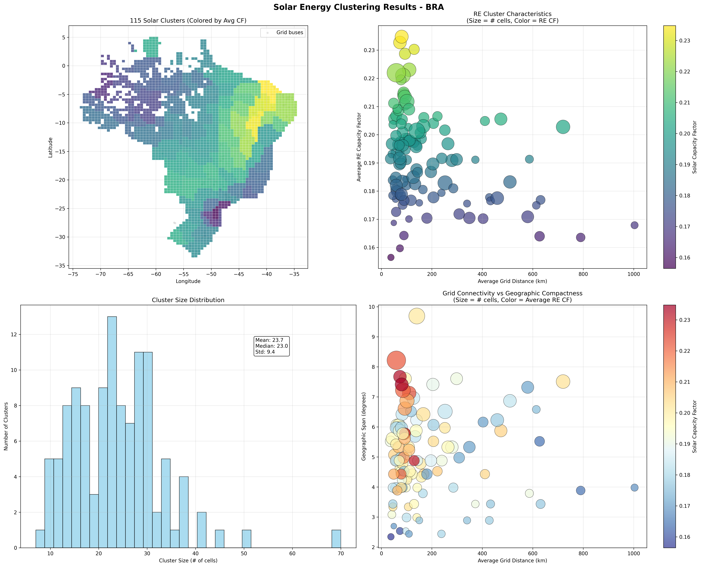
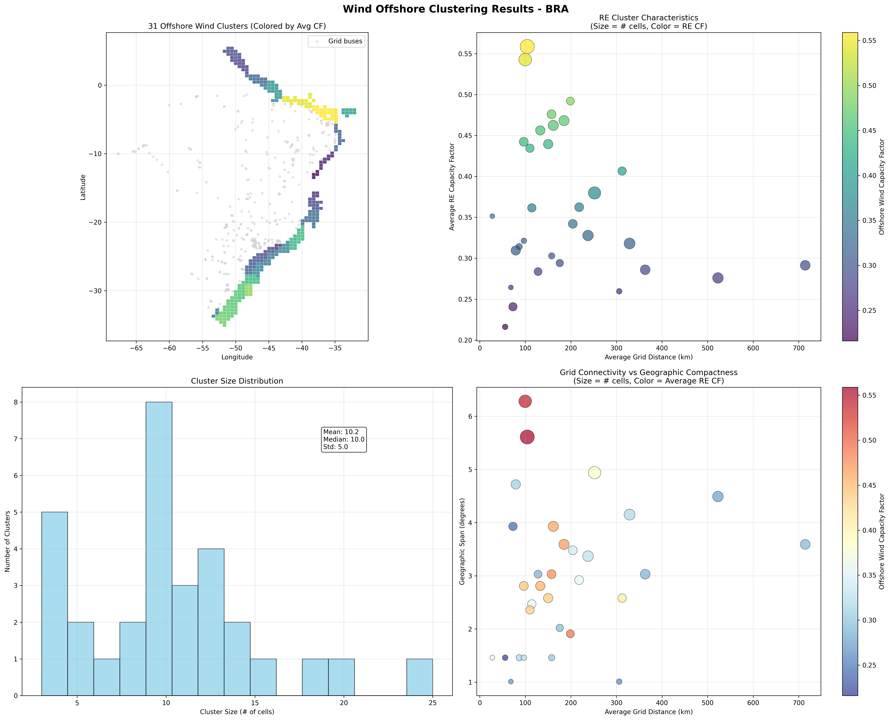
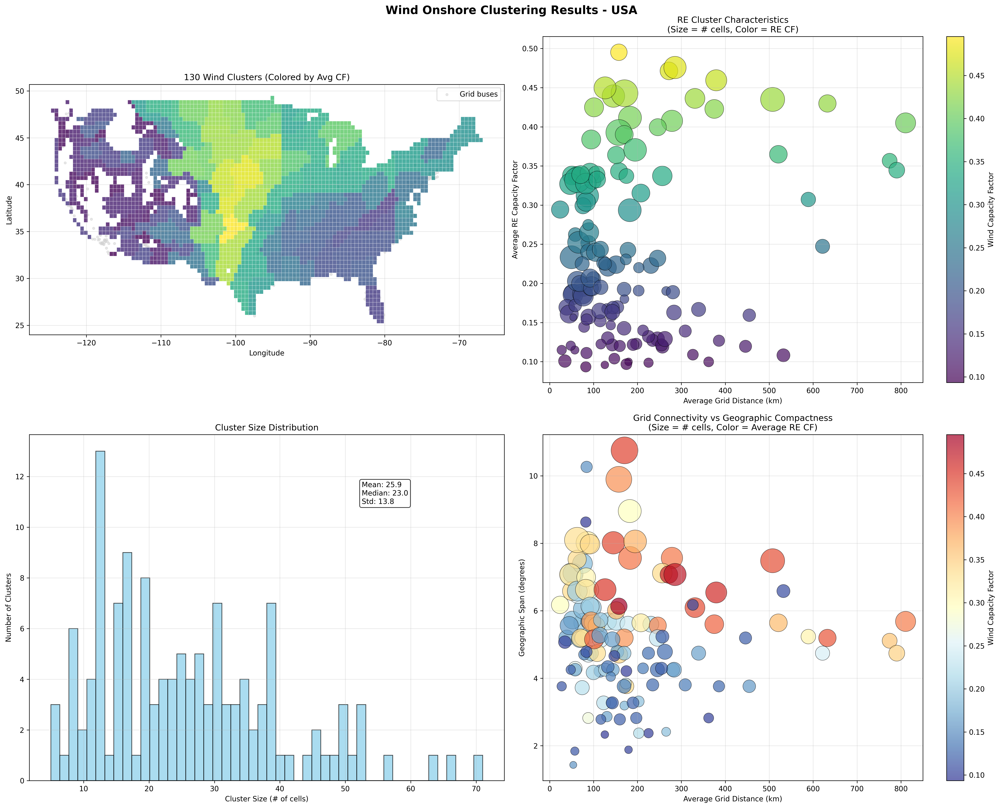
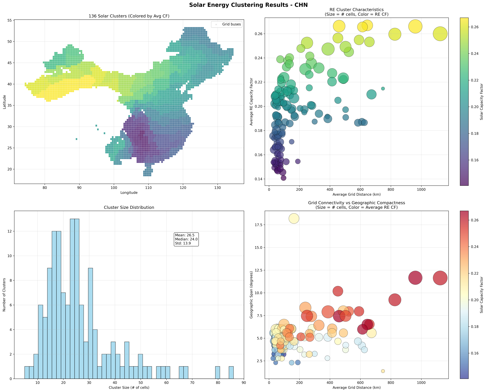
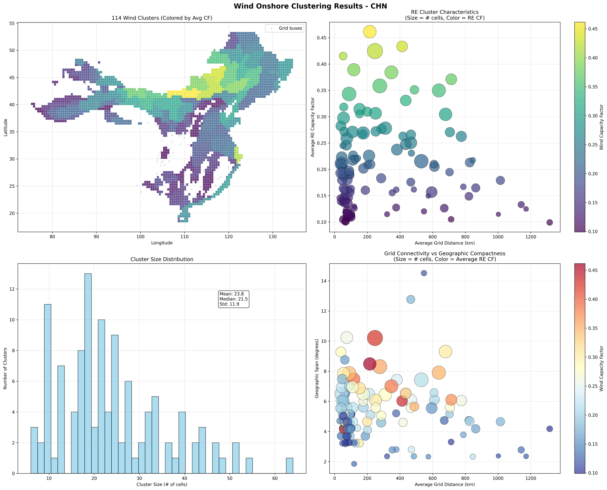

# Renewable Energy Characterization

**Where wind and sun can be built, how much, and what they produce hour by hour**

<figure class="vs-film" markdown="0">
  <video controls preload="none" playsinline poster="../../_static/films/deu_wind_and_sun.jpg">
    <source src="../../_static/films/deu_wind_and_sun.mp4" type="video/mp4">
  </video>
  <figcaption><strong>Watch first: Germany's Wind and Sun</strong> (2:02, narrated). Generated from a real build of the German model; every number on screen traces to a file. The sections below follow the film in the same order, with the rules and file names behind each step. Also: <a href="../../films/v/renewables_DEU.html">interactive version</a> · <a href="../../films/v/renewables_IND.html">India</a> · <a href="../../films/">all films</a>.</figcaption>
</figure>

## Overview

Thermal plants can be placed near demand. Wind and sun cannot: they are where the resource is. So the model needs to know, for every part of the country, how much could be built, what it would produce in each hour, and how far it is from the grid.

1.  **Cells.** Suitable area for solar, onshore wind and offshore wind on a 50 km grid, from the World Bank ESMAP REZoning study.
2.  **Land.** Where solar and wind claim the same land, split it between them.
3.  **Profiles.** An hourly capacity factor for every cell, from weather data.
4.  **Clusters.** Group the cells around each grid node into clusters, each with its own profile.
5.  **Connection.** Connect each cluster to its node at a cost that depends on distance.
6.  **Time slices.** Average each cluster's hourly profile into the model's time slices.

|                                                     | Germany (`kan20`)    | India (`kan50`)       |
|-----------------------------|----------------------|----------------------|
| Cells: solar / onshore / offshore                   | 188 / 189 / 38       | 1,489 / 1,477 / 234   |
| Solar potential before → after the land split (GW)  | 1,120 → 491          | 6,534 → 4,577         |
| Onshore wind potential before → after (GW)          | 1,362 → 786          | 5,740 → 1,823         |
| Offshore wind potential (GW)                        | 286                  | 527                   |
| Clusters: solar / onshore / offshore                | 41 / 41 / 10         | 78 / 66 / 24          |
| Annual potential, as a multiple of base-year demand | 3,505 TWh, 6.5 times | 10,813 TWh, 6.0 times |

***The two example countries***

!!! note

    How ERA5 weather is converted into hourly capacity factors (panel orientation, hub height, air density, power curve and local-time alignment) is documented in [Weather to Capacity Factors](weather-to-capacity-factors.md).

## Stage 1: Land-Use Conflict Resolution

**The Challenge: Avoiding Double-Counting**

REZoning datasets provide separate suitable area assessments for solar and onshore wind technologies. However, these assessments often overlap significantly, leading to potential double-counting of land resources in energy system models.

### LCOE-Based Overlap Adjustment Methodology

Contested land is shared in inverse proportion to cost: the cheaper technology in a cell gets the larger share.

**Core Algorithm:**

``` sql
-- For each (ISO, grid_cell) pair with both solar and wind potential:

-- 1. Calculate overlap area
overlap_area = MIN(solar_suitable_area, wind_suitable_area)

-- 2. Determine competing capacities in overlap grid cell
IF solar_area <= wind_area THEN
    solar_competing = solar_capacity  -- All solar competes
    wind_competing = (overlap_area / wind_area) * wind_capacity  -- Partial wind
ELSE
    wind_competing = wind_capacity   -- All wind competes  
    solar_competing = (overlap_area / solar_area) * solar_capacity  -- Partial solar

-- 3. Calculate LCOE-based allocation shares
lcoe_sum = solar_lcoe + wind_lcoe
solar_share = wind_lcoe / lcoe_sum  -- Higher wind LCOE = more solar allocation
wind_share = solar_lcoe / lcoe_sum  -- Higher solar LCOE = more wind allocation

-- 4. Allocate competing resources
solar_final = solar_competing * solar_share + solar_untouched
wind_final = wind_competing * wind_share + wind_untouched
```

**Key Principles:**

-   **Economic Rationality**: Cheaper technology (lower LCOE) receives larger share of contested land
-   **Conservative Approach**: Reduces total renewable potential to avoid over-optimistic assessments
-   **Technology Neutrality**: No arbitrary preferences - purely data-driven allocation
-   **Preservation of Non-Overlapping Resources**: Full potential maintained where no conflict exists

**Global Implementation:**

The methodology processes **100+ countries** simultaneously, applying identical logic to each (ISO, grid_cell) pair:

**Land-Use Adjustment Impact (Global)**

{{ read_csv('_static/data/landuse_adjustment_summary.csv', keep_default_na=False, dtype='str') }}

*The size of the reduction depends on how much the two suitable areas overlap. In Germany it more than halves the solar potential; see the table in the overview.*

## Stage 2: Renewable Resource Clustering

After the land split, the cells are grouped into clusters. A cluster is what the model sees: one investment option with a capacity limit, an hourly profile and a connection to one grid node.

### Clustering Methodology

Clustering is done separately for solar, onshore wind and offshore wind.

1.  **Filter.** Cells with an average capacity factor below 5% (solar) or 8% (wind) are dropped.
2.  **Catchments.** Every remaining cell is assigned to its nearest grid node. The cells of one node form its catchment.
3.  **Budget.** The number of clusters for the country (formula below) is shared among catchments in proportion to their potential, with at least one per catchment.
4.  **Cluster.** Inside each catchment, cells are grouped by hierarchical clustering with Ward linkage on their hourly profiles (reduced to at most 50 principal components), together with distance to the grid and location, weighted 50%, 40% and 10%.
5.  **Profile.** The cluster's hourly profile is the capacity-weighted average of its cells.

**A cluster never spans two nodes.** Clustering on profiles alone can put cells hundreds of kilometres apart into one cluster if their weather is alike, and the model could then connect the whole cluster wherever it liked. Clustering inside catchments rules that out.

**Dynamic Cluster Number Determination:** The number of clusters depends on the number of cells:

``` python
n_clusters = int(np.clip(n_cells ** 0.6, 10, 300))
```

India has 78 solar clusters and 66 onshore wind clusters, from 1,489 and 1,477 cells before filtering.

**The exponent and cap vary by model family.** The values above apply to single-country models. Multi-region models trade spatial detail for tractability across many regions and use a coarser setting, with the exponent recorded in the delivered artifact name so a model's granularity is always identifiable:

| **Model family** | **Exponent** | **Cap** |
|------------------|--------------|---------|
| Single-country   | 0.6          | 300     |
| Multi-region     | 0.4          | 100     |

***Clustering granularity by model family***

**Capacity-weighted profiles**

For each technology cluster, hourly generation profiles are computed using capacity-weighted averaging with technology-specific data:

``` python
def calculate_weighted_cluster_profiles_2(clusters, profiles, technology):
    """
    Calculate capacity-weighted cluster profiles for renewable technologies
    """
    cluster_profiles = {}
    for cluster_id in clusters:
        grid_cells_in_cluster = clusters[cluster_id]

        # Get capacity weights (MW potential)
        weights = profiles[grid_cells_in_cluster]['capacity_mw']

        # Calculate weighted average hourly profile
        weighted_profile = np.average(
            profiles[grid_cells_in_cluster]['hourly_cf'], 
            weights=weights, 
            axis=0
        )

        cluster_profiles[cluster_id] = weighted_profile

    return cluster_profiles
```

This approach ensures that grid cells with higher renewable energy potential have proportionally greater influence on the cluster's temporal generation pattern.

### Country Examples and Validation

!!! note

    The figures below were produced before clustering was confined to node catchments. They show the cell data and the scale of clustering; cluster boundaries in current builds differ.

**Brazil Solar Clustering (KAN Grid)**

 { width="100%" }

*Brazil Solar Resource Clustering - KAN Grid Definition*

-   **3,095 renewable grid cells processed**
-   **124 clusters created** (using dynamic scaling: 3,095\^0.6 ≈ 124)
-   **Average cluster size**: 25.0 grid cells per cluster
-   **Solar capacity factor**: 15.6% to 23.2% range (average 19.1%)
-   **Grid connectivity**: Distance to cities (CIT grid)
-   **Cluster size range**: 6 to 69 grid cells per cluster

**Brazil Offshore Wind Clustering (KAN Grid)**

 { width="100%" }

*Brazil Offshore Wind Resource Clustering - KAN Grid Definition*

-   **1,120 renewable grid cells processed**
-   **67 clusters created** (using dynamic scaling: 1,120\^0.6 ≈ 67)
-   **Average cluster size**: 16.7 grid cells per cluster
-   **Offshore wind capacity factor**: 36.8% to 55.8% range (average 46.8%)
-   **Grid connectivity**: Coastal transmission access
-   **Cluster size range**: 4 to 42 grid cells per cluster

**USA Onshore Wind Clustering (CIT Grid)**

 { width="100%" }

*USA Onshore Wind Resource Clustering - CIT Grid Definition*

-   **3,109 renewable grid cells processed**
-   **139 clusters created** (using dynamic scaling: 3,109\^0.6 ≈ 139)
-   **Average cluster size**: 22.4 grid cells per cluster
-   **Onshore wind capacity factor**: 17.1% to 29.3% range (average 22.8%)
-   **Grid connectivity**: Distance to cities (CIT grid)
-   **Cluster size range**: 4 to 68 grid cells per cluster

**China Solar Clustering (CIT Grid)**

 { width="100%" }

*China Solar Resource Clustering - CIT Grid Definition*

-   **4,047 renewable grid cells processed**
-   **165 clusters created** (using dynamic scaling: 4,047\^0.6 ≈ 165)
-   **Average cluster size**: 24.5 grid cells per cluster
-   **Solar capacity factor**: 11.2% to 21.8% range (average 16.2%)
-   **Grid connectivity**: Distance to cities (CIT grid)
-   **Cluster size range**: 3 to 89 grid cells per cluster

**China Onshore Wind Clustering (CIT Grid)**

 { width="100%" }

*China Onshore Wind Resource Clustering - CIT Grid Definition*

-   **4,047 renewable grid cells processed**
-   **165 clusters created** (using dynamic scaling: 4,047\^0.6 ≈ 165)
-   **Average cluster size**: 24.5 grid cells per cluster
-   **Onshore wind capacity factor**: 15.1% to 35.2% range (average 23.8%)
-   **Grid connectivity**: Distance to cities (CIT grid)
-   **Cluster size range**: 2 to 97 grid cells per cluster

These examples demonstrate how the clustering methodology adapts to different: - **Geographic scales**: From Brazil's focused coastal grid cells to China's continental expanse - **Resource characteristics**: Solar vs. wind temporal patterns and capacity factors - **Grid definitions**: KAN (infrastructure-based) vs. CIT (city-based) transmission proxies - **Technology types**: Independent clustering for onshore wind, offshore wind, and solar PV

## Stage 3: Cluster-Based Renewable Energy Integration

**Universal Clustering Approach**

VerveStacks applies **renewable energy clustering to all model architectures**, recognizing that geographic hedging of wind resources and spatial diversity are too important to ignore, regardless of transmission network detail. Both grid and non-grid models use the same clustering methodology from Stage 2, differing only in their approach to synthetic grid definition.

### Synthetic Grid Definition

**Grid Models: Infrastructure-Based Buses** - **Data Source**: Actual transmission infrastructure from OpenStreetMap - **Bus Definition**: Physical substations and transmission nodes - **Clustering Target**: Real transmission buses with known coordinates - **Grid Distance**: Actual distance to nearest transmission infrastructure

**Non-Grid Models: Population and Generation-Based Synthetic Buses** - **Data Source**: Population centers and generation clusters as bus proxies - **Bus Definition**: Major cities and industrial centers representing demand/supply nodes - **Clustering Target**: Synthetic buses based on economic activity and generation patterns - **Grid Distance**: Distance to nearest synthetic bus (population/generation center)

**Key Insight**: Both approaches result in similar cluster counts (10-300 clusters) and preserve essential geographic diversity for renewable resource hedging.

### Cluster-Based Renewable Integration

**Universal Methodology:**

1.  **Technology-Specific Cluster Commodities**:

    ``` python
    # Each technology gets separate cluster sets
    for cluster_id in solar_clusters:
        commodity = f"elc_spv_{iso_code}_{cluster_id:03d}"
        process = f"solar_resource_cluster_{cluster_id}"

    for cluster_id in wind_onshore_clusters:
        commodity = f"elc_won_{iso_code}_{cluster_id:03d}"
        process = f"wind_onshore_resource_cluster_{cluster_id}"

    for cluster_id in wind_offshore_clusters:
        commodity = f"elc_wof_{iso_code}_{cluster_id:03d}"
        process = f"wind_offshore_resource_cluster_{cluster_id}"
    ```

2.  **Technology-Specific Capacity-Weighted Temporal Profiles**:

    ``` python
    # Use technology-specific capacity-weighted cluster profiles
    for cluster_id in solar_clusters:
        solar_profile = solar_cluster_profiles[cluster_id]['weighted_cf']
        normalized_solar_profile = solar_profile / solar_profile.sum()

    for cluster_id in wind_onshore_clusters:
        wind_profile = wind_cluster_profiles[cluster_id]['weighted_cf']
        normalized_wind_profile = wind_profile / wind_profile.sum()
    ```

3.  **Technology-Specific Grid Connection Costs**:

    ``` python
    # Distance-based connection costs calculated separately per technology
    for cluster in solar_clusters:
        solar_connection_cost = 1.1 * cluster.avg_grid_dist_km  # M$/GW-km
        solar_transmission_losses = 1 - 0.00006 * cluster.avg_grid_dist_km

    for cluster in wind_clusters:
        wind_connection_cost = 1.1 * cluster.avg_grid_dist_km  # M$/GW-km
        wind_transmission_losses = 1 - 0.00006 * cluster.avg_grid_dist_km
    ```

    !!! note

        **Offshore wind uses a dedicated export-connection function.** A flat per-km rate has no fixed term and so cannot represent the offshore platform. Offshore connection cost takes the cheaper of an HVAC and an HVDC regime, then rebases regionally:

        ``` text
        cost = s * min(298 + 4.48 * d,      HVAC 220 kV with AC substation, 1 GW link
                       876 + 0.86 * d)      HVDC 525 kV bipole with converters, 2 GW link
        ```

        Cost is in USD21/kW, numerically M\$/GW, and `d` is the distance in km to the connecting node. The fixed terms carry the platform, and the crossover between regimes falls at roughly 160 km. The regional scalar `s` is 1.00 for Europe, 0.55 for China, 1.30 for the United States and 0.85 elsewhere. Solar and onshore wind use the flat per-km rate above.

**Grid Connection Architecture**

**Grid Models: Direct Bus Connection** - **Connection**: Clusters connect directly to specific transmission buses - **Transmission**: Explicit network constraints and power flow modeling - **Optimization**: Location-specific renewable deployment with transmission limits

**Non-Grid Models: National Copper Plate Connection** - **Connection**: Clusters connect to national copper plate after paying connection costs - **Transmission**: No internal transmission constraints (infinite capacity) - **Optimization**: Technology-level competition with geographic diversity preserved

**Economic Integration**

**Technology-Specific Output Files**

The separate clustering approach generates independent output files for each renewable technology:

-   **Solar**: `cluster_solar_atlite_timeseries.csv` (and `.parquet`)
-   **Onshore wind**: `cluster_wind_atlite_timeseries.csv`
-   **Offshore wind**: `cluster_offwind_atlite_timeseries.csv`
-   **Cluster summaries**: `cluster_summary_solar.csv`, `cluster_summary_wind_onshore.csv`, `cluster_summary_wind_offshore.csv`
-   **Cell-to-cluster maps**: `cell_to_cluster_mapping_<technology>.csv`

All are written to `1_grids/output_<design>/<ISO>/`.

Each file contains hourly capacity factor profiles for all clusters of that technology, enabling: - **Independent model validation** for each renewable type - **Technology-specific capacity expansion analysis** - **Separate temporal pattern analysis** (diurnal vs. weather-driven) - **Flexible model architecture** supporting different renewable integration strategies

Both model architectures incorporate identical economic signals:

-   **Connection Costs**: 1.1 M\$/GW-km, equivalently \$1.1 per kW per km, based on distance to nearest bus
-   **Transmission Losses**: 0.6% per 100 km following industry standards
-   **Geographic Hedging**: Wind resource diversity captured through cluster-specific profiles
-   **Capacity Factors**: Individual cluster profiles preserve spatial and temporal variations

**Output**: Multiple commodities per technology with cluster-specific profiles (e.g., `elc_spv_DEU_017`, `elc_spv_DEU_018`, ...)

**Grid vs. NoGrid Comparison:**

| **Aspect**                   | **NoGrid Models**                                   | **Grid Models**                                         |
|-------------------|-------------------------|-----------------------------|
| **Spatial Resolution**       | Renewable energy clusters (10-300 clusters)         | Renewable energy clusters (10-300 clusters)             |
| **Renewable Commodities**    | Multiple per technology (`elc_spv_ISO_###`)         | Multiple per technology (`elc_spv_ISO_###`)             |
| **Temporal Profiles**        | Capacity-weighted cluster profiles                  | Capacity-weighted cluster profiles                      |
| **Synthetic Grid Basis**     | Population and generation centers                   | Actual transmission infrastructure                      |
| **Transmission Modeling**    | National copper plate (infinite capacity)           | Explicit network constraints and power flows            |
| **Connection Costs**         | Distance to synthetic buses                         | Distance to transmission buses                          |
| **Use Cases**                | Policy analysis, scenario studies                   | Grid integration, network planning                      |
| **Computational Complexity** | Medium (clusters + copper plate)                    | High (clusters + transmission network)                  |
| **Geographic Hedging**       | Preserved through clustering                        | Preserved through clustering                            |
| **Economic Dispatch**        | Technology-level competition with spatial diversity | Location-specific optimization with transmission limits |

***Model Architecture Differences***

## Data Sources and Integration

**Primary Data Sources:**

| **Data Source**                 | **Content & Application**                                                                                                                                                                                    |
|----------------------|--------------------------------------------------|
| **REZoning Database**           | 50×50km grid cell renewable potential (LCOE, capacity factor, suitable area) for 100+ countries. Quality filtering applied: solar PV \>5% CF, onshore wind \>8% CF                                           |
| **Atlite Weather Data**         | Hourly capacity factors (8760 hours) for solar PV and wind technologies by grid cell, converted from ERA5 reanalysis. Conversion physics and settings: [Weather to Capacity Factors](weather-to-capacity-factors.md) |
| **EMBER Statistics**            | Base-year renewable generation, for calibration                                                                                                                                                              |
| **Global Energy Monitor (GEM)** | Existing renewable plant locations for spatial validation and gap-filling                                                                                                                                    |
| **OpenStreetMap (OSM)**         | Transmission network data for grid model bus-grid cell mapping                                                                                                                                               |

***Renewable Characterization Data Sources***

**Processing order:**

1.  Land split between solar and wind, for all countries at once
2.  Hourly profiles per cell
3.  Clustering inside node catchments
4.  Connection of each cluster to its node, with cost and losses
5.  Averaging of hourly profiles into time slices

## Into Time Slices

The model does not run on 8,760 hours. Every cluster keeps its own hourly profile, and that profile is averaged into the model's time slices. Several time-slice definitions are prepared for each country, from coarse to fine, and the same definitions are applied to every cluster and to demand:

| Country | Time slices per year in the prepared definitions |
|---------|--------------------------------------------------|
| Germany | 12, 24, 36, 48, 72, 132, 220                     |
| India   | 12, 24, 30, 40, 66, 132, 180                     |

See [Stress-Based Timeslice Design](stress-timeslices.md) for how the slices are chosen.

## The Gap the Grid Has to Close

Where the resource is and where the demand is rarely coincide, which is why the clusters are tied to nodes and the nodes to corridors.

-   **Germany**: 68% of wind potential lies north of 52°N; 72% of demand lies south.
-   **India**: 68% of wind potential lies west of 78°E; 68% of thermal capacity lies east.

## Limits to Know About

-   **Resolution.** Cells are 50 km. Local siting constraints below that scale are not seen.
-   **One weather year by default.** Profiles use 2013 unless another year is chosen; see [Weather to Capacity Factors](weather-to-capacity-factors.md).
-   **Land split by cost only.** The split between solar and wind uses cost shares. It does not model co-location of the two on the same land.
-   **Connection by straight line.** Connection cost uses the average distance from a cluster's cells to its node, not a routed line.

!!! info "See also"

    [Weather to Capacity Factors](weather-to-capacity-factors.md) for how the hourly grid-cell capacity factors used here are derived from ERA5 reanalysis.

    [Grid Representation](grid-representation.md) for transmission network modeling and technology connection methodology

